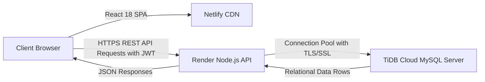

# 💼 WorkSphere HRMS (Enterprise Human Resource Management System)

> **Modern, full-stack enterprise workforce and people operations portal built for high reliability, role-based security, and zero-cost cloud deployment.**


---

## 📑 Table of Contents
1. [Project Overview](#-project-overview)
2. [Key Features & Modules](#-key-features--modules)
3. [User Roles & Permissions Matrix](#-user-roles--permissions-matrix)
4. [Technology Stack](#-technology-stack)
5. [Architecture & Data Flow](#-architecture--data-flow)
6. [Folder Structure](#-folder-structure)
7. [Database Schema & Seed Data](#-database-schema--seed-data)
8. [Local Development Setup](#-local-development-setup)
9. [Pre-Configured Demo Credentials](#-pre-configured-demo-credentials)
10. [REST API Documentation](#-rest-api-documentation)
11. [Free Zero-Cost Cloud Deployment (₹0 / month)](#-free-zero-cost-cloud-deployment-0--month)
    - [Step 1: TiDB Cloud Starter (Free MySQL Database)](#step-1-tidb-cloud-starter-free-mysql-database)
    - [Step 2: Render (Free Backend Web Service)](#step-2-render-free-backend-web-service)
    - [Step 3: Netlify (Free Frontend Web App)](#step-3-netlify-free-frontend-web-app)
12. [License & Author](#-license--author)

---

## 🌟 Project Overview

**WorkSphere** is an internal enterprise human resource portal designed for companies with 50–500+ employees. It bridges HR teams, executive leadership, managers, and employees into a unified interface for:
- 👥 Complete Employee Lifecycle & Directory Management
- ⏱️ Real-time Attendance & Shift Tracking (Punch-In / Punch-Out)
- 🏖️ Leave Management with Multi-tier Approval Workflows
- 🏢 Department & Team Allocation
- 💰 Automated Monthly Payroll Generation & Printable Payslip Slips
- 📊 Real-time Executive Analytics & CSV Export Reports

---

## 🚀 Key Features & Modules

| Module | Core Functionality |
| :--- | :--- |
| **Admin Dashboard** | Real-time headcount KPIs, attendance compliance rates, department charts, recent leaves, corporate announcements. |
| **Employee Directory** | Complete CRUD operations for staff records, role provisioning, department tagging, contact info, salary records, and account deactivation. |
| **Attendance Tracker** | Daily web punch clock with live elapsed time, automatic late arrival detection (> 09:30 AM), personal logs, and HR date-filtered audits. |
| **Leave Management** | Balance tracking (Casual, Sick, Privilege, Parental, Comp-Off), leave application form with duration calculation, and manager approval/rejection notes. |
| **Department Management** | Division records with assigned leads, description, headcount tracking, and department deletion safety checks. |
| **Payroll & Compensation** | Automated salary calculation (Base + Allowances - Deductions = Net Pay), payment disbursement ledger, and **printable / downloadable corporate payslips**. |
| **Reports & Analytics** | Monthly attendance aggregation tables, department headcount breakdowns, payroll budget projections, and **one-click Export to CSV**. |

---

## 🔐 User Roles & Permissions Matrix

WorkSphere implements robust **Role-Based Access Control (RBAC)** across the backend and frontend:

| Capability | Admin 👑 | HR Lead 💼 | Manager 👔 | Employee 💻 |
| :--- | :---: | :---: | :---: | :---: |
| View System Dashboard | ✅ | ✅ | ✅ | ✅ (Personal) |
| Add / Edit Employees | ✅ | ✅ | ❌ | ❌ |
| Deactivate Employees | ✅ | ❌ | ❌ | ❌ |
| Create / Edit Departments | ✅ | ✅ | ❌ | ❌ |
| Daily Punch-In / Punch-Out | ✅ | ✅ | ✅ | ✅ |
| View Company-Wide Attendance | ✅ | ✅ | ✅ (Team) | ❌ (Own only) |
| Apply for Personal Leave | ✅ | ✅ | ✅ | ✅ |
| Approve / Reject Leaves | ✅ | ✅ | ✅ | ❌ |
| Generate & Disburse Payroll | ✅ | ✅ | ❌ | ❌ |
| View / Print Personal Payslip | ✅ | ✅ | ✅ | ✅ |
| Export Analytics to CSV | ✅ | ✅ | ✅ | ❌ |

---

## 🛠️ Technology Stack

| Layer | Technology | Purpose |
| :--- | :--- | :--- |
| **Frontend Framework** | **React.js 18 (Vite)** | Lightning-fast component rendering & modern SPA routing |
| **Styling & Icons** | **Custom Modern CSS + Lucide Icons** | Professional corporate SaaS UI styling matching Linear/Gusto |
| **Routing & Auth** | **React Router v6 + Context API** | Client-side routing, route guards, token persistence |
| **HTTP Client** | **Axios** | REST communication with JWT interceptors |
| **Backend Runtime** | **Node.js (v18+)** | High-performance asynchronous JavaScript engine |
| **Web Server Framework**| **Express.js** | RESTful routing, middleware pipelines, CORS handling |
| **Security & Auth** | **JWT (JSON Web Token) + Bcrypt.js**| Stateless token authentication & salted password hashing |
| **Database** | **MySQL 8.0 / TiDB Cloud Starter** | Relational transactional persistence, ACID compliance |
| **Database Driver** | **mysql2/promise** | Asynchronous connection pooling with TLS/SSL encryption |

---

## 🏗️ Architecture & Data Flow



---

## 📁 Folder Structure

```
WorkSphere/
├── database/
│   └── worksphere.sql             # Complete schema, tables, FKs and enterprise seed data
├── backend/
│   ├── config/
│   │   ├── db.js                  # MySQL / TiDB connection pool + fallback mock store
│   │   └── mockStore.js           # Seamless zero-setup demo data
│   ├── controllers/
│   │   ├── authController.js      # Login, profile, password change
│   │   ├── employeeController.js  # Employee CRUD
│   │   ├── departmentController.js# Department CRUD
│   │   ├── attendanceController.js# Punch in/out & attendance logs
│   │   ├── leaveController.js     # Apply & approve/reject leave requests
│   │   ├── payrollController.js   # Payroll generation & payslips
│   │   └── reportController.js    # Dashboard KPIs & attendance summaries
│   ├── middleware/
│   │   ├── auth.js                # JWT verification
│   │   ├── rbac.js                # Role authorization guards
│   │   └── errorHandler.js        # Global error interception
│   ├── routes/                    # Express route routers
│   ├── .env                       # Environment configuration
│   ├── .env.example               # Environment template
│   ├── package.json
│   └── server.js                  # Main server entrypoint
├── frontend/
│   ├── public/
│   ├── src/
│   │   ├── components/
│   │   │   ├── Navbar.jsx         # Top navigation, user greeting, role badge
│   │   │   ├── Sidebar.jsx        # Role-filtered side navigation
│   │   │   ├── StatCard.jsx       # Metric cards with iconography
│   │   │   ├── Modal.jsx          # Accessible modal dialog
│   │   │   ├── PayslipModal.jsx   # Corporate printable payslip document
│   │   │   └── ProtectedRoute.jsx # Role-based route guard
│   │   ├── context/
│   │   │   └── AuthContext.jsx    # Authentication & user state management
│   │   ├── pages/
│   │   │   ├── Login.jsx          # Login view with instant 1-click demo fill
│   │   │   ├── Dashboard.jsx      # Role-tailored dashboard & live punch clock
│   │   │   ├── Employees.jsx      # Staff directory & employee management
│   │   │   ├── Attendance.jsx     # Shifts, check-in/out and history
│   │   │   ├── Leaves.jsx         # Leave applications & approval workflows
│   │   │   ├── Departments.jsx    # Divisions & team leadership
│   │   │   ├── Payroll.jsx        # Salary ledger & payslips
│   │   │   └── Reports.jsx        # Analytics & CSV exports
│   │   ├── services/
│   │   │   └── api.js             # Centralized Axios client & API endpoints
│   │   ├── App.jsx
│   │   ├── App.css
│   │   ├── index.css
│   │   └── main.jsx
│   ├── index.html
│   ├── vite.config.js
│   └── package.json
└── README.md
```

---

## 🗄️ Database Schema & Seed Data

The database script `database/worksphere.sql` creates:
- `departments`: Divisions, codes, manager tags
- `users`: Staff credentials, roles (`admin`, `hr`, `manager`, `employee`), designations, base salaries
- `attendance`: Daily punch timestamps, calculated work hours, status (`present`, `late`, `half_day`, `absent`)
- `leave_types`: Allotments (Casual, Sick, Privilege, Parental)
- `leave_requests`: Leave date intervals, status (`pending`, `approved`, `rejected`), manager notes
- `payroll`: Monthly salary calculation, allowances, deductions, net salary, payment method, payment status (`paid`, `pending`)
- `announcements`: Corporate noticeboard

---

## 🔑 Pre-Configured Demo Credentials

For quick testing without typing, the Login page includes **Instant Demo Quick-Fill** buttons:

| Role | Email | Password | Access Level |
| :--- | :--- | :--- | :--- |
| **Admin** | `admin@worksphere.com` | `admin123` | Full administrative control |
| **HR Lead** | `hr@worksphere.com` | `hr123` | Employee, department, payroll, reports |
| **Manager** | `manager@worksphere.com` | `manager123` | Team attendance, leave approvals |
| **Employee** | `employee@worksphere.com` | `employee123` | Personal clock-in, leave apply, payslips |

*(Note: universal fallback password `password123` is also supported).*

---

## 💻 Local Development Setup

### 1. Clone or Open Workspace
```bash
cd WorkSphere
```

### 2. Set Up the MySQL Database
Open your MySQL terminal or MySQL Workbench:
```bash
mysql -u root -p < database/worksphere.sql
```

### 3. Configure Backend Environment
Navigate to `backend/` and inspect `.env`:
```env
PORT=5000
DB_HOST=127.0.0.1
DB_PORT=3306
DB_USER=root
DB_PASSWORD=your_mysql_password
DB_NAME=worksphere
TIDB_ENABLE_SSL=false
JWT_SECRET=worksphere_enterprise_super_secret_jwt_key_2026
CLIENT_URL=http://localhost:5173
```

### 4. Run the Backend Server
```bash
cd backend
npm install
npm run dev
# Server will start on http://localhost:5000
```

### 5. Run the React Frontend
```bash
cd frontend
npm install
npm run dev
# Vite dev server will start on http://localhost:5173
```

Open `http://localhost:5173` in your browser!

---

## 📡 REST API Documentation

### Auth
- `POST /api/auth/login`: Authenticate and receive JWT token
- `GET /api/auth/me`: Get current authenticated user profile
- `PUT /api/auth/change-password`: Update account password

### Employees
- `GET /api/employees`: List staff (supports `department_id`, `role`, `status`, `search`)
- `GET /api/employees/:id`: Get single employee profile
- `POST /api/employees`: Add new employee (Admin/HR)
- `PUT /api/employees/:id`: Update employee details (Admin/HR)
- `DELETE /api/employees/:id`: Deactivate employee (Admin)

### Attendance
- `POST /api/attendance/check-in`: Record today's check-in
- `POST /api/attendance/check-out`: Record check-out & compute total hours
- `GET /api/attendance/today`: Today's punch status for current user
- `GET /api/attendance/my`: Personal attendance history
- `GET /api/attendance/all`: Organization-wide attendance (Admin/HR/Manager)

### Leave Management
- `GET /api/leaves/types`: List allowable leave types & quotas
- `POST /api/leaves`: Submit new leave application
- `GET /api/leaves/my`: List personal leave applications
- `GET /api/leaves/all`: List company leave requests (Admin/HR/Manager)
- `PUT /api/leaves/:id/status`: Approve or reject leave with notes (Admin/HR/Manager)

### Payroll
- `GET /api/payroll/all`: List company payroll records (Admin/HR)
- `GET /api/payroll/my`: List personal salary disbursements
- `POST /api/payroll/generate`: Generate or recalculate monthly payslip (Admin/HR)
- `PUT /api/payroll/:id/status`: Mark payroll as Paid or Processing (Admin/HR)
- `GET /api/payroll/:id/payslip`: Detailed payslip document data

### Reports
- `GET /api/reports/dashboard`: Summary statistics and KPIs
- `GET /api/reports/attendance-summary`: Aggregated monthly attendance counts per employee

---

## 🌐 Free Zero-Cost Cloud Deployment (₹0 / month)

You can deploy the complete WorkSphere HRMS to the web for free with 0 server costs using the setup below:

### Step 1: TiDB Cloud Starter (Free MySQL Database)
1. Sign up at [TiDB Cloud](https://tidbcloud.com) (No credit card required).
2. Create a free **Serverless / Starter** cluster (gives you 5 GiB storage and 50M request units/mo for ₹0).
3. Under cluster settings, note your connection details:
   - Host: `gateway01.us-east-1.prod.aws.tidbcloud.com`
   - Port: `4000`
   - User: `<cluster_prefix>.root`
   - Password: `<your_password>`
   - Database: `worksphere`
4. Open the SQL Editor on TiDB Cloud and paste the contents of `database/worksphere.sql` to initialize tables and seed data.

### Step 2: Render (Free Backend Web Service)
1. Sign up at [Render.com](https://render.com).
2. Create a **New Web Service** connected to your GitHub repository.
3. Set the Root Directory to `backend`.
4. Build Command: `npm install`
5. Start Command: `node server.js`
6. Add Environment Variables:
   - `DB_HOST`: `<your_tidb_host>`
   - `DB_PORT`: `4000`
   - `DB_USER`: `<your_tidb_user>`
   - `DB_PASSWORD`: `<your_tidb_password>`
   - `DB_NAME`: `worksphere`
   - `TIDB_ENABLE_SSL`: `true`
   - `JWT_SECRET`: `<secure_random_string>`
   - `CLIENT_URL`: `https://your-app-name.netlify.app`
7. Click **Deploy Web Service**. You will receive a URL like `https://worksphere-api.onrender.com`.

### Step 3: Netlify (Free Frontend Web App)
1. Sign up at [Netlify.com](https://netlify.com).
2. Click **Add new site** > **Import an existing project** from GitHub.
3. Configure build settings:
   - Base directory: `frontend`
   - Build command: `npm run build`
   - Publish directory: `frontend/dist`
4. Add Environment Variable:
   - `VITE_API_URL`: `https://worksphere-api.onrender.com/api`
5. Click **Deploy site**.
6. Netlify will generate a live URL (e.g. `https://worksphere-hrms.netlify.app`).

Your live portfolio-ready enterprise HRMS application is now online at ₹0 monthly cost! 🚀

---

## 📄 License
This project is open-source and available under the [MIT License](LICENSE).
